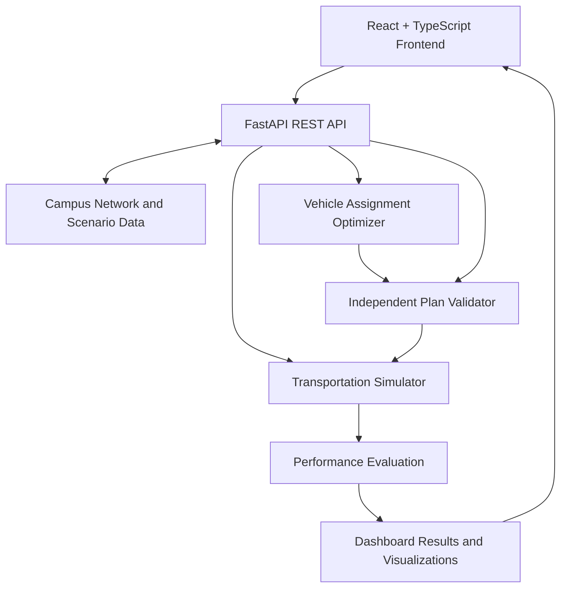

# RoutePulse

[](https://routepulse-frontend.vercel.app/)

**Campus Transportation Planning & Optimization** \
A data-driven platform for campus shuttle operations, disruption recovery, and performance analysis.

[](https://github.com/)
[](https://www.python.org/)
[](https://fastapi.tiangolo.com/)
[](https://react.dev/)
[](https://www.typescriptlang.org/)
[](https://vite.dev/)
[](https://tailwindcss.com/)
[](https://lucide.dev/)
[](https://recharts.org/)
[](https://axios-http.com/)
[](https://leafletjs.com/)

## Overview

RoutePulse is a campus shuttle planning and operations platform developed as a team project for the **Wild Bugs 2026 Hackathon**.

It helps explore transportation planning decisions using a configured campus network, passenger demand, scheduled trips, and disruption scenarios. Users can generate vehicle assignment plans, validate operational constraints, simulate transportation services, and compare baseline performance with an optimized candidate.

## Features

### Operations Dashboard

- Campus network overview with routes, stops, vehicles, scheduled trips, and passenger demand.
- Interactive map with route geometry and stop markers.
- Operational KPIs, demand visualizations, and capacity-related alerts.
- Timetable-based arrival estimates.

### Recovery Planner

- Explore predefined transportation disruption scenarios.
- Generate vehicle assignment plans based on the selected network and scenario.
- Review plan feasibility and constraint validation findings.
- Inspect proposed schedule and assignment changes.

### Performance Lab

- Compare baseline and candidate transportation plans.
- Analyze passenger waiting times, service coverage, capacity violations, distance, and operational cost.
- Visualize performance metrics and changes using interactive charts.
- Review evaluation summaries and detailed results.

### Planning and Simulation

- Vehicle assignment and schedule constraint validation.
- Passenger demand and vehicle movement simulation.
- Scenario-based demand and travel-time adjustments.
- Baseline-versus-candidate performance evaluation.

## Technology Stack

| Category | Technologies |
| --- | --- |
| Frontend | React, TypeScript, Vite |
| Styling | Tailwind CSS |
| API Client | Axios |
| Data Visualization | Recharts |
| Maps | Leaflet, React Leaflet |
| Icons | Lucide React |
| Backend | Python, FastAPI, Uvicorn |
| Data Validation | Pydantic |
| Data Processing | NumPy, pandas |
| Testing | pytest, HTTPX |

## Architecture



The frontend handles dashboard presentation, user interaction, maps, and charts. The FastAPI backend manages network data, scenario processing, plan generation, validation, simulation, and evaluation.

For detailed module organization and API contracts, see [ARCHITECTURE.md](docs/architecture).

## How It Works

1. **Load the network:** Retrieve campus stops, routes, vehicles, schedules, and demand data.
2. **Select a scenario:** Choose a predefined scenario representing normal operations or a transportation disruption.
3. **Generate a plan:** Request a candidate vehicle assignment plan from the backend.
4. **Validate constraints:** Check assignments and schedules against the configured operational rules.
5. **Simulate services:** Evaluate passenger and vehicle outcomes for the baseline and feasible candidate plans.
6. **Compare results:** Review performance metrics, visualizations, findings, and proposed changes in the dashboard.

## Dataset

RoutePulse includes a configured campus transportation dataset for repeatable scenario analysis.

| Data entity | Records |
| --- | --- |
| Stops | 40 |
| Routes | 10 |
| Vehicles | 25 |
| Scheduled trips | 200 |
| Passenger demand groups | 900 |
| Disruption scenarios | 5 |

Available scenarios:

- `normal`
- `demand_surge`
- `road_closure`
- `traffic_delay`
- `vehicle_failure`

The dataset includes network geometry, scheduled services, passenger demand, and supporting simulation fixtures. It provides a consistent basis for exploring transportation planning and disruption recovery.

## Repository Structure

```text
routepulse/
├── api/                    # Root-level deployment entrypoint
├── backend/
│   ├── api/                # Backend deployment entrypoint
│   ├── app/
│   │   ├── api/            # FastAPI routes and dependencies
│   │   ├── evaluation/     # Baseline and candidate comparison
│   │   ├── optimizer/      # Vehicle assignment and planning
│   │   ├── prediction/     # Demand, ETA, and risk utilities
│   │   ├── schemas/        # Pydantic data models
│   │   ├── simulation/     # Transportation simulation
│   │   └── validation/     # Plan constraint validation
│   ├── scripts/            # Dataset utilities
│   ├── tests/              # Backend tests
│   └── pyproject.toml
├── data/
│   ├── network/            # Campus network data
│   ├── scenarios/          # Scenario definitions
│   └── *.json              # Demand and simulation fixtures
├── frontend/
│   ├── src/
│   │   ├── api/            # API clients and adapters
│   │   ├── components/     # Dashboard, maps, and charts
│   │   ├── hooks/          # Data and request state
│   │   ├── lib/            # Utility functions
│   │   ├── pages/          # Application pages
│   │   └── types/          # TypeScript types
│   └── package.json
├── docs/
├── ARCHITECTURE.md
└── README.md
```

## Getting Started

### Prerequisites

- Python 3.11 or newer
- Node.js 20.19 or newer
- npm
- Git

### 1. Clone the repository

```bash
git clone https://github.com/muhammad-waqas99/routePulse.git
cd routepulse
```


### 2. Start the backend

Open a terminal in the repository root:

```powershell
cd backend
py -3.11 -m venv .venv
```

Activate the virtual environment:

```powershell
.\.venv\Scripts\Activate.ps1
```

Install the backend and development dependencies:

```powershell
python -m pip install -e ".[dev]"
```

Start the API server:

```powershell
uvicorn app.main:app --reload --port 8000
```

The backend API will be available at:

- API: `http://localhost:8000`
- Health check: `http://localhost:8000/health`
- Interactive API documentation: `http://localhost:8000/docs`

### 3. Start the frontend

Open a second terminal:

```powershell
cd frontend
npm ci
```

Create `frontend/.env.local` using the provided `.env.example` file, if available, and configure the backend API URL:

```env
VITE_API_BASE_URL=http://localhost:8000
```

Start the frontend:

```powershell
npm run dev
```

Open `http://localhost:5173` in your browser.

## API Reference

The backend exposes REST endpoints for network data, scenarios, optimization, validation, simulation, and performance evaluation.

| Method | Endpoint | Description |
| --- | --- | --- |
| `GET` | `/health` | Check API health |
| `GET` | `/api/v1/network` | Retrieve campus network data |
| `GET` | `/api/v1/scenarios` | List disruption scenarios |
| `POST` | `/api/v1/optimize` | Generate and validate a candidate plan |
| `POST` | `/api/v1/validate` | Validate a submitted plan |
| `POST` | `/api/v1/evaluate` | Compare baseline and candidate performance |
| `POST` | `/api/v1/scenarios/{scenario_id}/run` | Run a scenario simulation |
| `GET` | `/api/v1/operations/overview` | Retrieve dashboard data |
| `GET` | `/api/v1/evaluations` | List evaluation summaries |
| `GET` | `/api/v1/evaluations/{evaluation_id}` | Retrieve evaluation details |
| `GET` | `/api/v1/runs/{run_id}` | Retrieve simulation run details |

For request schemas and response formats, visit `/docs` while the backend is running.

## Configuration

| Variable | Used by | Purpose |
| --- | --- | --- |
| `VITE_API_BASE_URL` | Frontend | Base URL of the backend API |
| `ROUTEPULSE_CORS_ORIGINS` | Backend | Comma-separated frontend origins permitted by the API |

For deployment, configure the frontend's API URL to point to the deployed backend and configure the backend's CORS origins to include the frontend's exact production origin.

Redeploy the relevant service after changing its environment variables.

## Development

Run backend tests:

```powershell
cd backend
python -m pytest -q
```

Build the frontend:

```powershell
cd frontend
npm run build
```

Run frontend linting:

```powershell
npm run lint
```

## Hackathon Context

RoutePulse was developed as a team project for the **Wild Bugs 2026 Hackathon**, with a focus on campus transportation planning, operational constraints, disruption recovery, and performance analysis.

---

Built with React, TypeScript, Python, and FastAPI.
