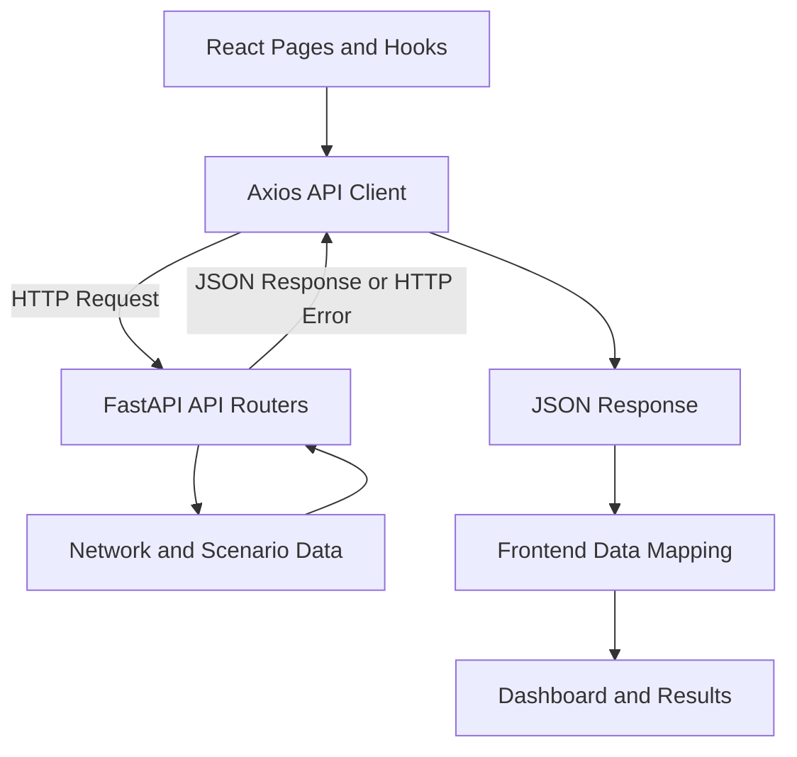

# Frontend and Backend Integration

## 1. Communication

The React frontend uses Axios through `frontend/src/api/client.ts` to communicate with the FastAPI backend.

The client uses `VITE_API_BASE_URL` as the backend origin and appends `/api/v1` unless the configured value already ends with that path. Requests use JSON and have a 15-second timeout.

## 2. API Endpoints

| Endpoint | Purpose |
| --- | --- |
| `GET /api/v1/operations/overview` | Loads operational data, including routes, stops, vehicles, trips, demand, and alerts. |
| `GET /api/v1/network` | Loads route segment travel and distance details. |
| `GET /api/v1/scenarios` | Provides scenarios for the Recovery Planner and Performance Lab. |
| `POST /api/v1/evaluate` | Evaluates baseline and candidate plans. |
| `GET /api/v1/evaluations` | Loads recent evaluation summaries. |
| `GET /api/v1/evaluations/{evaluation_id}` | Loads details for a selected evaluation. |

The frontend's primary optimization workflow uses `/api/v1/evaluate` rather than the plan-only `/api/v1/optimize` endpoint.

## 3. Requests and Responses

The backend returns JSON responses. Pydantic models validate and serialize responses for endpoints that define a `response_model`. The operations overview is returned as JSON assembled by its router.

Frontend API modules map backend `snake_case` fields into frontend domain types. The operations overview and network requests run together so their data can be combined before rendering.

React hooks and pages handle loading states and request failures. If data cannot be loaded, an error message is displayed. Optimization errors reset the run state and are shown in the Recovery Planner or Performance Lab.

## 4. Request Flow



The frontend sends HTTP requests through Axios. FastAPI processes requests using the relevant API routes and returns JSON responses or HTTP errors. The frontend maps the returned data into its own types and displays the results.

## 5. Configuration

### Local Development

Set the backend URL in `frontend/.env.local`:

```env
VITE_API_BASE_URL=http://localhost:8000
```

Run the FastAPI backend on port `8000` and the Vite frontend on port `5173`.

The backend must allow the frontend origin through `ROUTEPULSE_CORS_ORIGINS`.

### Deployment

Configure the following environment variables:

| Variable | Purpose |
| --- | --- |
| `VITE_API_BASE_URL` | Backend production URL used by the frontend. |
| `ROUTEPULSE_CORS_ORIGINS` | Frontend origin or origins allowed by the backend. |
| `ROUTEPULSE_DATA_DIR` | Directory containing the backend's network, scenario, and other required data files. |

Set `VITE_API_BASE_URL` in the frontend deployment to the backend's production URL. Set `ROUTEPULSE_CORS_ORIGINS` in the backend environment to include the deployed frontend's origin.

After changing frontend environment variables, rebuild and redeploy the frontend if required by the hosting platform.