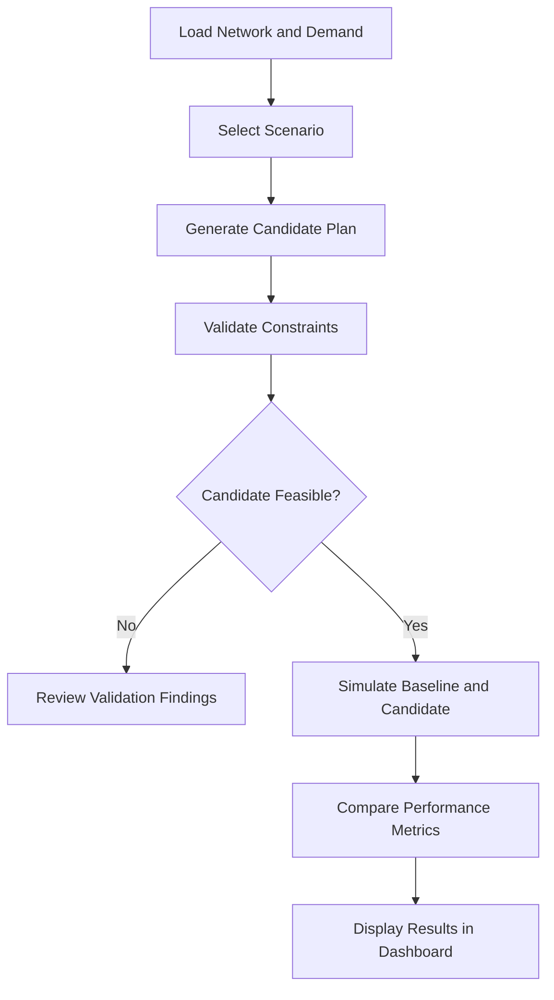
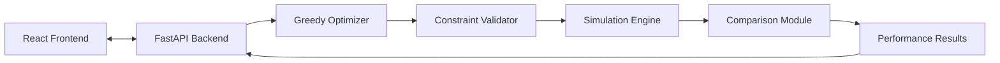

# RoutePulse — Optimization & Validation

## Overview

RoutePulse generates candidate vehicle assignment plans, validates operational constraints, simulates transportation activity, and compares results against a baseline plan.

## 1. Optimization

RoutePulse uses a deterministic greedy algorithm with weighted candidate scoring to generate vehicle assignments.

The planner considers vehicle availability, route compatibility, scheduling requirements, passenger demand, capacity, vehicle distance, and operating cost.

If a candidate does not improve the weighted objective while maintaining feasibility, the baseline assignment is retained.

## 2. Constraint Validation

Each candidate plan is independently checked against the configured transportation network and operational requirements.

Validation covers:

- Trip coverage and vehicle assignments.
- Route and vehicle compatibility.
- Vehicle availability and scheduling conflicts.
- Departure windows, turnaround, and route headways.
- Passenger capacity when demand data is available.
- Transfer connections when sufficient connection data is provided.

Only candidates that pass the required feasibility checks proceed to performance simulation.

## 3. Transportation Simulation

RoutePulse uses discrete-event simulation to model passenger and vehicle activity under configured scenarios.

Key metrics include:

- Passenger waiting time.
- Served, unserved, and abandoned passengers.
- Capacity violations.
- Vehicle distance and operating costs, where available.
- Vehicle breakdown effects.

## 4. Baseline Comparison

The baseline and candidate plans are evaluated under the same configured scenario and evaluation settings.

The comparison highlights changes in passenger service, waiting time, capacity violations, vehicle distance, and operating cost where available.

Results help users understand performance improvements and trade-offs without assuming every candidate will outperform the baseline.

## 5. End-to-End Workflow

## 6. System Interaction

## 7. Technology Stack

| Component | Technology |
|---|---|
| Frontend | React, TypeScript, Vite |
| Backend API | FastAPI |
| Planning | Python greedy optimizer |
| Validation | Constraint validator |
| Simulation | Discrete-event simulation |
| Data Models | Pydantic |
| Visualization | Recharts, Leaflet |

## Summary

**Generate Plan → Validate → Simulate → Compare → Review**

RoutePulse combines vehicle assignment planning, independent constraint validation, and simulation-based evaluation to support more informed campus transportation decisions.
