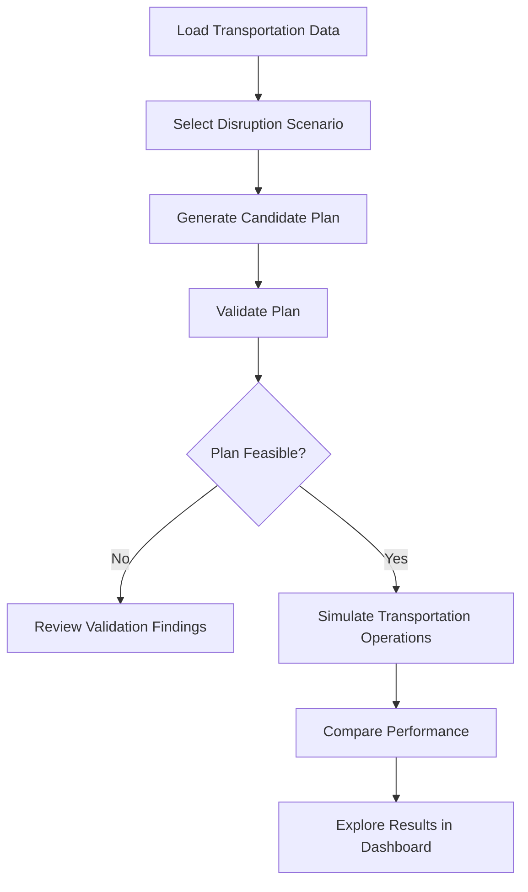

# RoutePulse — Problem Statement & Solution

## 1. Problem Statement

Campus transportation systems must coordinate routes, vehicle capacities, schedules, and passenger demand while maintaining reliable service. Disruptions such as traffic delays, overcrowding, and vehicle breakdowns can make existing schedules inefficient or infeasible.

**The challenge:** is to develop a system that can analyze transportation conditions, recommend feasible adjustments, and measure improvements against a baseline.

## 2. Our Solution

RoutePulse is a campus transportation planning platform that helps users visualize transportation networks, explore disruption scenarios, generate vehicle assignment plans, and evaluate their performance.

It combines an interactive dashboard with a FastAPI backend to support planning, validation, simulation, and performance comparison.

## 3. Key Features

### Campus Network Dashboard

- Interactive map of campus routes and stops.
- Overview of vehicles, schedules, and passenger demand.
- Operational metrics and capacity-related alerts.

### Disruption Scenario Analysis

Explore different transportation conditions, including:

- Normal operations.
- Increased passenger demand.
- Road closures.
- Traffic delays.
- Vehicle failures.

### Vehicle Assignment Planning

Generate candidate vehicle assignments based on fleet availability, scheduling requirements, route compatibility, and operational constraints.

### Constraint Validation

Check candidate plans for scheduling conflicts, vehicle compatibility, trip coverage, and other operational constraints.

### Transportation Simulation

Simulate passenger and vehicle activity to evaluate waiting times, passenger service, vehicle distance, and operating costs where data is available.

### Performance Comparison

Compare baseline and candidate plans through KPI cards, charts, maps, and service performance metrics.

## 4. End-to-End Workflow

RoutePulse separates planning, validation, and simulation to help users evaluate candidate plans before comparing their performance with the baseline.

## 5. Technology Stack

| Component | Technology |
| --- | --- |
| Frontend | React, TypeScript, Vite |
| Styling | Tailwind CSS |
| Mapping | Leaflet, React Leaflet |
| Charts | Recharts |
| Backend API | FastAPI |
| Data Validation | Pydantic |
| Planning and Simulation | Python |

## 6. Expected Impact

RoutePulse supports more informed campus transportation planning through:

- **Operational visibility:** View routes, stops, vehicles, schedules, and demand in one place.
- **Disruption analysis:** Explore different transportation scenarios.
- **Feasibility-aware planning:** Validate candidate vehicle assignments.
- **Performance evaluation:** Compare service outcomes, distance, and operating costs.
- **Clear visualization:** Understand results through maps, charts, and key metrics.

The current implementation uses configured and simulated data to support repeatable scenario analysis. Its results represent modeled outcomes rather than guaranteed improvements in a live transportation network.

## 7. Project Outcome

RoutePulse connects the core stages of transportation planning:

**Observe → Analyze → Plan → Validate → Simulate → Compare**

By bringing these stages together, RoutePulse demonstrates how interactive visualization, operational planning, and simulation can help investigate campus transportation challenges.