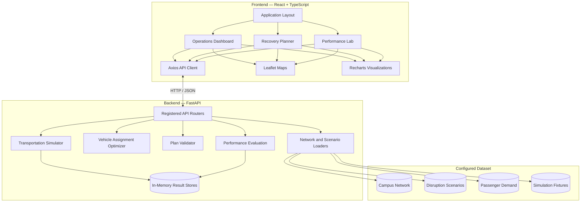
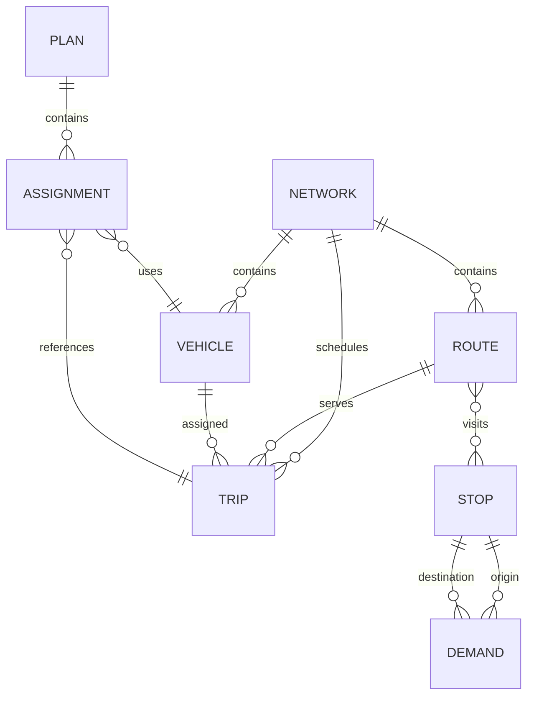
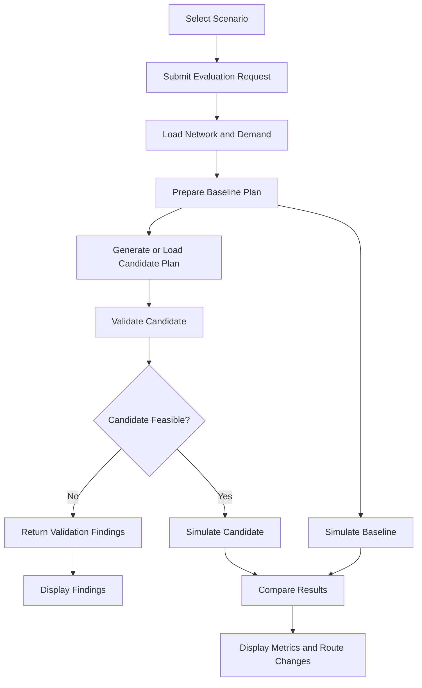

# RoutePulse Architecture

This document describes the architecture of RoutePulse, including its frontend, backend services, data flow, API contracts, and deployment configuration.

For the project overview and setup instructions, see [README.md](README.md). For vehicle assignment and constraint validation details, see [docs/OPTIMIZATION_AND_VALIDATION.md](docs/OPTIMIZATION_AND_VALIDATION.md).

## 1. System Architecture



RoutePulse separates the user interface from the backend planning workflow.

- **Frontend:** Displays operational information, accepts scenario selections, and presents maps, charts, and evaluation results.
- **Backend:** Loads network data, generates candidate plans, validates constraints, simulates transportation activity, and compares results.
- **Dataset:** Provides the configured campus network, passenger demand, disruption scenarios, and supporting simulation records.

The backend exposes a REST API through FastAPI. The frontend communicates with it using Axios.

## 2. Frontend Architecture

### Application Structure

The frontend is built with React, TypeScript, Vite, and Tailwind CSS. Its main application entry point is `frontend/src/main.tsx`, which renders the application layout.

The application contains three main pages:

| Page | Responsibilities |
|---|---|
| Operations Dashboard | Network overview, operational KPIs, demand charts, alerts, and campus map |
| Recovery Planner | Scenario selection, candidate plan generation, validation findings, and schedule comparison |
| Performance Lab | Evaluation history, baseline-versus-candidate metrics, charts, and route comparisons |

### API Client and Data Adapters

The Axios client is defined in `frontend/src/api/client.ts`. API modules organize requests and transform backend responses into frontend view models.

| Module | Responsibility |
|---|---|
| `api/client.ts` | Shared HTTP client and API base URL |
| `api/operation.ts` | Operations overview and network data |
| `api/scenarios.ts` | Scenario retrieval and presentation |
| `api/optimization.ts` | Evaluation requests and optimization response mapping |
| `api/evaluation.ts` | Evaluation summaries and detailed results |

Custom hooks manage request state, loading indicators, errors, and evaluation results.

### Maps and Visualizations

RoutePulse uses Leaflet and React Leaflet for interactive network maps, and Recharts for operational and performance charts.

- `CampusMap.tsx` displays the operations network, route geometry, and stop and vehicle markers.
- `SimulationChangeMap.tsx` compares baseline and candidate route layers.
- `PerformanceRouteMap.tsx` presents route comparisons for a selected evaluation.

The map components visualize configured network and evaluation data, while planning and simulation calculations remain in the backend.

## 3. Backend Architecture

The backend is implemented in Python using FastAPI and Pydantic.

The application entry point is `backend/app/main.py`. It creates the FastAPI application, configures CORS, and registers the API routers.

### Core Modules

| Module | Responsibility |
|---|---|
| `app/main.py` | Application initialization and router registration |
| `app/api/` | REST endpoints and request handling |
| `app/schemas/` | Network, scenario, plan, and result models |
| `app/optimizer/` | Candidate vehicle assignment and planning |
| `app/validation/` | Independent operational constraint validation |
| `app/simulation/` | Passenger and vehicle event simulation |
| `app/evaluation/` | Baseline-versus-candidate comparison |
| `app/prediction/` | Demand forecasting, ETA estimation, and risk utilities |

### Planning and Optimization

The active planning workflow uses `app/optimizer/solve.py` to generate a candidate vehicle assignment plan. The implementation uses deterministic greedy assignment and candidate scoring based on applicable planning inputs.

The generated plan is checked independently by the validation module before it is used for candidate performance simulation.

### Validation

The validator checks the candidate against the configured network and applicable operational constraints, including:

- Trip coverage and assignment references.
- Vehicle compatibility and availability.
- Departure windows and schedule overlaps.
- Turnaround time and route headway.
- Capacity and optional connection constraints.

The validation result includes feasibility information and any reported violations or unverified constraints.

### Simulation and Evaluation

The simulation engine models passenger arrivals, boarding, vehicle movement, waiting deadlines, and breakdown events using configured inputs.

The evaluation module compares baseline and candidate outcomes using available metrics, such as waiting time, passenger service, capacity violations, distance, and operating cost.

Evaluation summaries and simulation runs are kept in process-local in-memory stores for retrieval during the running backend process.

The prediction package provides additional demand, ETA, and risk utilities. The core dashboard workflow is based on the registered API endpoints and configured dataset.

## 4. Repository Structure

```text
routepulse/
├── api/
│   └── index.py
├── backend/
│   ├── api/
│   │   └── index.py
│   ├── app/
│   │   ├── api/
│   │   ├── evaluation/
│   │   ├── optimizer/
│   │   ├── prediction/
│   │   ├── schemas/
│   │   ├── simulation/
│   │   ├── validation/
│   │   └── main.py
│   ├── scripts/
│   ├── tests/
│   ├── data/
│   └── pyproject.toml
├── data/
│   ├── network/
│   ├── scenarios/
│   ├── demand.json
│   ├── demand_history.json
│   ├── trip_history.json
│   ├── bus_status.json
│   └── gps/
├── frontend/
│   ├── src/
│   │   ├── api/
│   │   ├── components/
│   │   ├── hooks/
│   │   ├── lib/
│   │   ├── pages/
│   │   ├── types/
│   │   ├── App.tsx
│   │   └── main.tsx
│   └── package.json
├── docs/
├── ARCHITECTURE.md
├── INTEGRATION.md
├── README.md
└── docker-compose.yml
```

The root `data/` directory contains the configured dataset. The `backend/data/` directory supports deployments where the backend directory is selected as the deployment root.

## 5. Data Models

The principal models represent the transportation network, scheduled services, demand, planning decisions, and evaluation results.

| Model | Purpose |
|---|---|
| `Stop` | Represents a campus stop and its geographic location |
| `Route` | Defines an ordered sequence of stops and route characteristics |
| `Vehicle` | Describes vehicle capacity, type, availability, and operating properties |
| `Trip` | Represents a scheduled service assigned to a route and vehicle |
| `Scenario` | Defines operating conditions and disruption parameters |
| `PassengerDemand` | Represents passenger groups, origins, destinations, and waiting requirements |
| `Plan` | Contains trip assignments and related planning information |
| `ValidationReport` | Describes plan feasibility and constraint findings |
| `SimulationResult` | Contains simulation metrics, events, and passenger outcomes |
| `EvaluateResponse` | Combines baseline and candidate results with their comparison |

### Relationships



Scenario parameters affect the planning and simulation inputs. Plans are validated before candidate simulation, and the resulting metrics are used for baseline comparison.

For exact field definitions, refer to the Pydantic models under `backend/app/schemas/` and the simulation models under `backend/app/simulation/`.

## 6. API Contracts

The API uses JSON request and response bodies. Versioned application endpoints use the `/api/v1` prefix, except for the health check.

| Method | Endpoint | Purpose |
|---|---|---|
| `GET` | `/health` | Check backend health |
| `GET` | `/api/v1/network` | Retrieve campus network data |
| `GET` | `/api/v1/scenarios` | List available scenarios |
| `POST` | `/api/v1/scenarios/{scenario_id}/run` | Run a scenario simulation |
| `POST` | `/api/v1/optimize` | Generate and validate a candidate plan |
| `POST` | `/api/v1/validate` | Validate a submitted plan |
| `POST` | `/api/v1/evaluate` | Compare baseline and candidate performance |
| `GET` | `/api/v1/operations/overview` | Retrieve dashboard data |
| `GET` | `/api/v1/evaluations` | List evaluation summaries |
| `GET` | `/api/v1/evaluations/{evaluation_id}` | Retrieve an evaluation |
| `GET` | `/api/v1/runs/{run_id}` | Retrieve a simulation run |

### Main Evaluation Flow

The frontend primarily uses `POST /api/v1/evaluate` for the Recovery Planner and Performance Lab workflows.

The endpoint loads the relevant inputs, uses a supplied baseline or creates a fallback baseline, and uses a supplied candidate or requests one from the optimizer. The candidate is validated before simulation. Feasible candidates are simulated and compared with the baseline.

The response includes the evaluation identifier, plans, available simulation results, comparison metrics, and related notes.

The separate optimization endpoint can generate and validate a plan without running the full evaluation workflow.

For interactive request and response schemas, run the backend and visit `/docs`.

## 7. End-to-End Workflows

### Operations Dashboard

1. The frontend requests the operations overview and network data.
2. The backend loads the configured network, demand, and supporting operational data.
3. The operations endpoint assembles the dashboard view model and applicable alerts.
4. The frontend displays the results in KPI cards, charts, and the interactive map.

### Recovery Planning and Evaluation



The same configured demand, scenario, and simulation seed are used for the baseline and feasible candidate comparison when the evaluation workflow creates both results.

### Evaluation Retrieval

The Performance Lab retrieves evaluation summaries and requests the selected evaluation's detailed result. Simulation run identifiers can also be used to retrieve individual stored runs.

## 8. Configuration and Deployment

### Environment Variables

| Variable | Purpose |
|---|---|
| `VITE_API_BASE_URL` | Frontend base URL for the backend API |
| `ROUTEPULSE_CORS_ORIGINS` | Comma-separated frontend origins permitted by the backend |
| `ROUTEPULSE_DATA_DIR` | Optional backend data directory override |

The frontend Axios client defaults to `http://localhost:8000` and appends `/api/v1` when required.

For a deployed application, set `VITE_API_BASE_URL` to the backend's stable production origin. Configure `ROUTEPULSE_CORS_ORIGINS` with the exact frontend origin, including the scheme and hostname.

### Vercel Deployment

The repository includes entrypoints for deploying the backend from either the repository root or the `backend/` directory.

When deploying with `backend/` as the Vercel Root Directory:

1. Ensure `backend/api/index.py` is included.
2. Include the complete runtime dataset under `backend/data/`.
3. Set `ROUTEPULSE_DATA_DIR=/var/task/data`.
4. Configure `ROUTEPULSE_CORS_ORIGINS` with the deployed frontend origin.
5. Set the frontend's `VITE_API_BASE_URL` to the backend's stable production domain.
6. Redeploy after changing environment variables.

Use `/health` to check the deployed backend.

### Local Development and Docker

Backend dependencies and development tooling are defined in `backend/pyproject.toml`. Frontend dependencies and scripts are defined in `frontend/package.json`.

The root `docker-compose.yml` provides a local setup for running the frontend and backend services together. See [README.md](README.md) for installation and startup commands.

---

RoutePulse's architecture connects network data, scenario-based planning, independent validation, simulation, and performance comparison through a single dashboard and REST API.
